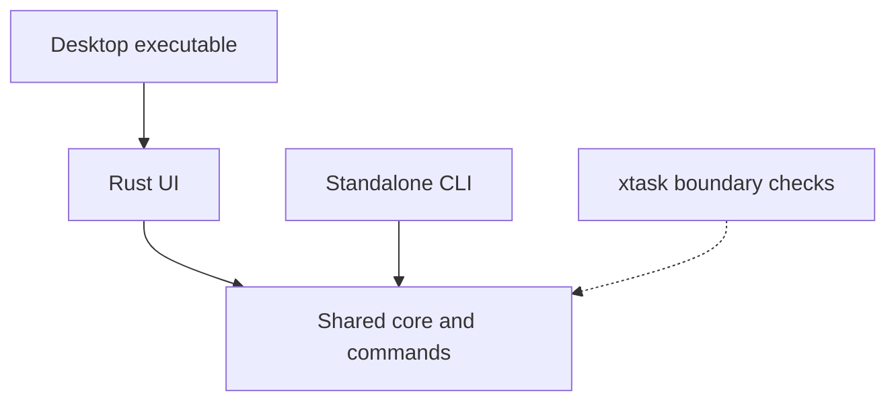

# Architecture

## Current scope

The Rust workspace provides read-only ZIP/ZIP64 metadata and bounded Stored/Deflate previews through shared core operations, a desktop browser, and a standalone CLI. Filename interpretation retains original bytes and supports explicit fallback/recovery choices. The desktop uses one bounded worker for archive I/O and prepared views. See [current ZIP contracts](zip-browser.md). Extraction, creation, transactional editing, additional providers, and the complete reference UI remain implementation work in [issue #1](https://github.com/stokaro/arcforge/issues/1).

## Workspace

| Location | Package | Responsibility |
| --- | --- | --- |
| `crates/core` | `arcforge-core` | UI-independent models, operation/capability registry, and shared command behavior |
| `crates/ui-egui` | `arcforge-ui-egui` | Rust desktop presentation and interaction over the shared core |
| `apps/arcforge` | `arcforge` | Desktop executable and platform entry point |
| `apps/arcforge-cli` | `arcforge-cli` | Headless command-line interface over the same core |
| `xtask` | `xtask` | Checks, builds, tests, and portable development packaging |

The core must not depend on `egui`, `eframe`, windowing, or native dialog libraries. The CLI depends on shared core behavior without importing the UI. The desktop executable connects platform startup to the UI. `cargo xtask check` enforces the configured workspace boundaries alongside the other development checks.

## Shared operations

Commands have stable identities and explicit availability. The GUI and CLI consume the same registry; unsupported operations remain unsupported in both interfaces. A placeholder panel or catalog entry is not evidence that an archive format or operation works.

The current ZIP provider is in `crates/core/src/archive`. The desktop and CLI use its `open_archive`, `reinterpret`, and `preview_entry` operations. Future provider integrations also belong behind core-facing interfaces. Each provider must expose operation-specific capabilities: listing, extraction, creation, editing, testing, encryption, and volume handling. Do not infer write support from a file extension or read support.

The current document contains immutable archive metadata and filename policy. Changing filename interpretation preserves entry IDs and source bytes; it is not a staged content edit. The planned editing model will stage edits, expose undo, and commit a validated replacement without losing the source archive on failure. Progress events and precise partial-extraction reporting remain requirements for future operations.

## Document generations and background results

The read-only desktop implements this snapshot/generation approach adapted from [hiewbie](hiewbie-reuse.md). `ArchiveSnapshot` owns metadata and source state; its per-open identity and central-directory entry IDs remain stable during reinterpretation. The UI advances a checked generation on open, close, and interpretation changes, and gives each request a separate checked identity. It applies a completion only when the exact generation/request ticket is current, and preview results must also match the selected entry.

One persistent worker performs archive reads, search/cache preparation, filename reinterpretation, and bounded previews. Request and reply channels are bounded; the UI retains at most one latest pending request and cancels superseded work. Prepared names, folder paths, and preview rows have explicit limits and are rendered through virtualized lists. Cancellation invalidates the current ticket without blocking the UI while the worker finishes. The source and resource limits are documented in [the ZIP contract](zip-browser.md).

Maintain a distinct document identity and a monotonically increasing generation. For future editing operations, also advance the generation when staged contents change, including undo/redo, when the backing source changes or is replaced, and when provider selection or settings change the interpretation of the document. Never reuse a generation for the same document identity; handle counter exhaustion explicitly. Keep one document-wide generation until measurements justify finer invalidation.

Start each indexing, search, preview, metadata, or validation job against a defined snapshot. Capture the document identity, generation, backing-source identity, provider/configuration revision, and job/request identity. A snapshot may own immutable metadata and a bounded source reader; it does not imply copying the entire archive into memory. Describe the source's consistency guarantees, including how external writes, truncation, or replacement are detected. A pathname or timestamp alone is not proof that the bytes are unchanged.

Apply results only while the captured document generation and relevant request remain current. Perform that comparison at the state-update boundary, together with checking cancellation, so a result cannot pass an earlier check and then overwrite a later edit. Request identity also matters when a user changes a search query or selected preview without changing document contents. Ignore stale progress and completion events, release resources owned by that job, and leave current UI/document state untouched. Cancellation is cooperative; its arrival does not prove a worker has stopped or undo a completed filesystem write.

Key derived caches by the snapshot identity plus the operation's inputs, such as entry identity, search query, decoding choice, or preview limits. Stable entry identifiers alone are insufficient across generations. Do not retain references into provider-owned buffers after their snapshot/source is invalidated. Either own the needed metadata or keep an explicitly owned snapshot alive.

Save and extraction have additional effects: bind each operation to its source snapshot, check source conflicts before a promised commit, and track the operation's staged and published outputs. If the document changes while saving, follow an explicit conflict/reconciliation policy instead of marking the new document generation as saved. Discarding a stale result must not silently delete already published extraction output; report partial results and preserve the existing source-preservation guarantees.

Current headless tests cover stale open/preview completions, newer requests, cancellation, close, and interpretation/search state. Extend this coverage to edit/undo, provider replacement, and published outputs when those operations are implemented. Assert that current state and unrelated files remain intact, including when completion and invalidation race.

## Large files and checked offsets

The following boundaries apply to the current ZIP reader and future providers:

- Represent archive sizes and offsets with checked `u64`-based types. Distinguish physical archive offsets, uncompressed entry offsets, and in-memory slice offsets at interfaces where mixing them is possible. Do not make the host pointer width the file-size limit.
- Use checked arithmetic for range ends, entry counts, accumulated sizes, and compression limits. Validate a range against the relevant source or entry length before reading. Reject overflow, truncation, and inconsistent metadata with a useful error; do not wrap or silently clamp them into apparently valid positions.
- Convert a length or offset to `usize` only after selecting a bounded buffer/slice and checking conversion. An archive-supplied length is not permission to allocate that amount of memory. Bound individual buffers, total memory, output expansion, metadata counts, and work independently.
- Stream or page data as the provider allows. Report seek/preview capabilities truthfully: compressed or solid archives may require sequential decoding or a bounded temporary spool. Do not assume constant-time random access or import a hex editor's piece-table model into compressed archive storage.
- Keep metadata and read handles associated with the source snapshot above. Handle an external truncate/replace as a source consistency event rather than continuing with offsets derived from different bytes.

Provider acceptance tests must include files/ranges beyond 4 GiB, boundary arithmetic near `u64::MAX`, malformed declared lengths, truncated sources, and cancellation/resource-limit exits. Use sparse files or synthetic bounded readers where appropriate; test streaming memory behavior without requiring enormous committed fixtures. ZIP64 metadata support does not imply an unbounded preview: the current preview reads only complete small Stored/Deflate entries and verifies CRC32. Broader extraction and storage behavior remains future work.

## UI and platform decisions

The desktop uses egui/eframe as the initial Rust UI implementation. It accepts one startup path, a path entered in the Open window, or a native file drop. A native file picker, drag-out, menus, accessibility, input methods, multiple windows, and HiDPI behavior still require implementation or verification on the supported desktops, including native Wayland and X11. Headless rendering tests do not complete toolkit feasibility work.

OS integrations and any narrowly required native glue must be isolated. The primary targets are Windows, macOS, and Linux on x86-64 and ARM64. FreeBSD core/CLI portability is secondary; browser/WASM support is future work.

The current Windows desktop executable uses the console subsystem, so launching it may also open a console window. A production GUI-subsystem entry point and its diagnostics behavior remain platform integration work; the standalone CLI must retain normal console output and exit codes.

## ArtCraft influence

The `crates/` + `apps/` + `xtask` organization, engine-first interfaces, executable dependency checks, and reference-comparison workflow follow patterns studied in PhotoCraft and Craft Anything. The exact copied/adapted files, revisions, and license choices are documented in [artcraft-reuse.md](artcraft-reuse.md). The entire ArtCraft framework is not a dependency of this scaffold.

[hiewbie-reuse.md](hiewbie-reuse.md) records the additional workflow, release-verification, and document-contract adaptations. Its platform roadmap does not expand ArcForge's six primary native targets.
