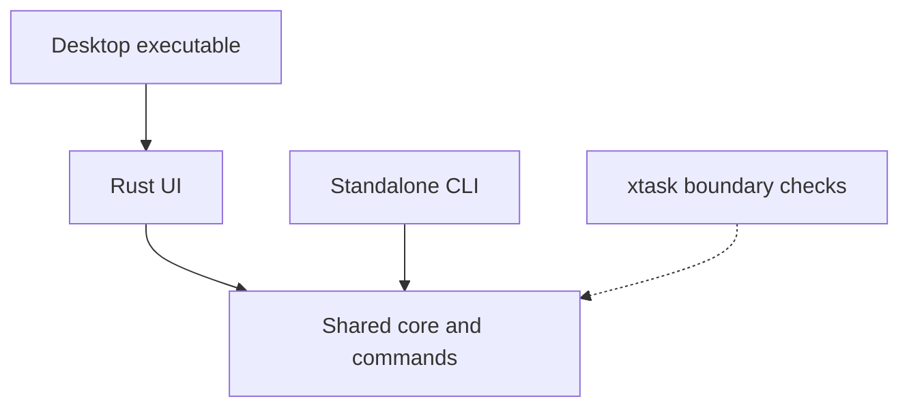

# Architecture

## Current scope

This is the initial Rust workspace and application scaffold. It establishes dependency boundaries, shared operation metadata, a desktop shell, a standalone CLI, and portable build tooling. Archive reading, extraction, compression, transactional editing, and the complete reference UI remain implementation work in [issue #1](https://github.com/stokaro/arcforge/issues/1).

## Workspace

| Location | Package | Responsibility |
| --- | --- | --- |
| `crates/core` | `arcforge-core` | UI-independent models, operation/capability registry, and shared command behavior |
| `crates/ui-egui` | `arcforge-ui-egui` | Rust desktop presentation and interaction over the shared core |
| `apps/arcforge` | `arcforge` | Desktop executable and platform entry point |
| `apps/arcforge-cli` | `arcforge-cli` | Headless command-line interface over the same core |
| `xtask` | `xtask` | Checks, builds, tests, and portable development packaging |

The core must not depend on `egui`, `eframe`, windowing, or native dialog libraries. The CLI depends on shared core behavior without importing the UI. The desktop executable connects platform startup to the UI. `cargo xtask check` enforces the configured workspace boundaries alongside the other development checks.

## Shared operations

Commands have stable identities and explicit availability. The GUI and CLI consume the same registry; unsupported operations remain unsupported in both interfaces. A placeholder panel or catalog entry is not evidence that an archive format or operation works.

Future provider integrations belong behind core-facing interfaces. Each provider must expose operation-specific capabilities: listing, extraction, creation, editing, testing, encryption, and volume handling. Do not infer write support from a file extension or read support.

The planned document model stages edits, exposes undo, and commits a validated replacement without losing the source archive on failure. Background jobs need bounded work, progress events, cancellation, and precise partial-extraction reporting. These contracts will be implemented incrementally rather than encoded as successful stubs.

## UI and platform decisions

The scaffold uses egui/eframe as the initial Rust UI implementation. This is not completion of the toolkit feasibility work: native drag-in/drag-out, menus, accessibility, input methods, multiple windows, and HiDPI behavior still require verification on all supported desktops, including native Wayland and X11.

OS integrations and any narrowly required native glue must be isolated. The primary targets are Windows, macOS, and Linux on x86-64 and ARM64. FreeBSD core/CLI portability is secondary; browser/WASM support is future work.

The current Windows desktop executable uses the console subsystem, so launching it may also open a console window. A production GUI-subsystem entry point and its diagnostics behavior remain platform integration work; the standalone CLI must retain normal console output and exit codes.

## ArtCraft influence

The `crates/` + `apps/` + `xtask` organization, engine-first interfaces, executable dependency checks, and reference-comparison workflow follow patterns studied in PhotoCraft and Craft Anything. The exact copied/adapted files, revisions, and license choices are documented in [artcraft-reuse.md](artcraft-reuse.md). The entire ArtCraft framework is not a dependency of this scaffold.
