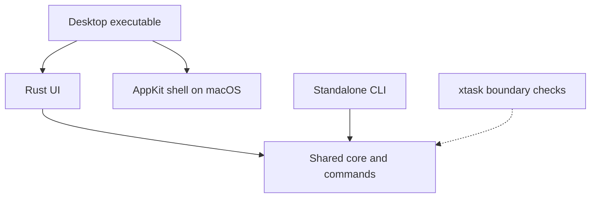

# Architecture

## Current scope

The Rust workspace provides ZIP/ZIP64 metadata, bounded Stored/Deflate previews, and extraction into a new directory through shared core operations, a desktop browser, and a standalone CLI. Filename interpretation retains original bytes and supports explicit fallback/recovery choices. The desktop uses one bounded worker for archive I/O and prepared views. See [current ZIP contracts](zip-browser.md). Existing-directory merge, creation, transactional editing, additional providers, and the complete reference UI remain implementation work in [issue #1](https://github.com/stokaro/arcforge/issues/1).

## Workspace

| Location | Package | Responsibility |
| --- | --- | --- |
| `crates/core` | `arcforge-core` | UI-independent models, operation/capability registry, and shared command behavior |
| `crates/ui-egui` | `arcforge-ui-egui` | Rust desktop presentation and interaction over the shared core |
| `crates/platform-macos` | `arcforge-platform-macos` | macOS AppKit toolbar, menus and typed native command/state boundary |
| `apps/arcforge` | `arcforge` | Desktop executable and platform entry point |
| `apps/arcforge-cli` | `arcforge-cli` | Headless command-line interface over the same core |
| `xtask` | `xtask` | Checks, builds, tests, and portable development packaging |

The core must not depend on `egui`, `eframe`, windowing, or native dialog libraries. The CLI depends on shared core behavior without importing the UI. The desktop executable connects platform startup to the UI. `cargo xtask check` enforces the configured workspace boundaries alongside the other development checks.

### Native presentation boundary

On macOS, the desktop entry point attaches an actual `NSToolbar` and `NSMenu` to its own `NSWindow`. AppKit owns window controls, toolbar layout/materials, menu interaction, search and overflow; egui renders the document contents below it. The adapter has no core or egui dependency. The executable maps its typed commands to the same UI command dispatcher used by portable controls, and mirrors availability, selection, navigation and search state back to AppKit. Unsupported operations remain disabled. The portable toolbar remains available on Windows/Linux and as an explicit attach-failure fallback; a fallback cannot pass macOS native-shell capture acceptance.

The only application-owned unsafe code is the private macOS interoperation module, using typed `objc2` bindings and main-thread-only retained objects. Its [safety contract](../crates/platform-macos/README.md) covers target/action ABI, weak native delegate ownership, teardown and owned-window identification. Core, CLI, UI and all other workspace packages retain the unsafe-code prohibition.

Normal Open and extraction-parent selection use `rfd` native asynchronous panels parented to the real application window. The UI starts and polls the future on its main thread; it retains native `PathBuf` values independently of lossy display text. One pending picker prevents duplicate panels. A document generation guards each result, so cancellation or a stale completion cannot replace a newer document. An extraction parent choice is followed by a compact scope/new-folder review; final placement still uses the core's exclusive new-directory contract. A deliberate advanced Open-by-path action remains secondary.

Filesystem Favorites use a separate worker for actual platform Desktop, Documents and Downloads locations, falling back to an existing Home directory when none are available. Discovery and directory reads happen off the UI thread and cannot cancel an archive job. Scans inspect immediate children only, limited to 512 entries, 1 MiB of retained metadata and 500 ms checked between filesystem calls. OS-blocked calls are not preemptible. The cache holds at most 32 directories with 16 pending requests; per-path generations reject superseded results. Display labels are separate from native paths. A ZIP badge reports a complete immediate scan of regular `.zip` candidates, not recursive totals or proven-valid archives; partial/error listings have no complete-count badge. Persistence, custom places and recursive indexing remain planned.

## Shared operations

Commands have stable identities and explicit availability. The GUI and CLI consume the same registry; unsupported operations remain unsupported in both interfaces. A placeholder panel or catalog entry is not evidence that an archive format or operation works.

The current ZIP provider is in `crates/core/src/archive`. The desktop and CLI use its `open_archive`, `reinterpret`, `preview_entry`, and `extract_archive` operations. Future provider integrations also belong behind core-facing interfaces. Each provider must expose operation-specific capabilities: listing, extraction, creation, editing, testing, encryption, and volume handling. Do not infer write support from a file extension or read support.

The current document contains immutable archive metadata and filename policy. Changing filename interpretation preserves entry IDs and source bytes; it is not a staged content edit. The planned editing model will stage edits, expose undo, and commit a validated replacement without losing the source archive on failure. Extraction uses a validated plan, bounded streaming, progress events, and precise partial-output reporting; it never modifies the source archive.

## Document generations and background results

The desktop implements this snapshot/generation approach adapted from [hiewbie](hiewbie-reuse.md). `ArchiveSnapshot` owns metadata and source state; its per-open identity and central-directory entry IDs remain stable during reinterpretation. The UI advances a checked generation on open, close, and interpretation changes, and gives each request a separate checked identity. It applies a completion only when the exact generation/request ticket is current, and preview results must also match the selected entry.

One persistent worker performs archive reads, search/cache preparation, filename reinterpretation, bounded previews, extraction, staged editing and Save As. Request and reply channels are bounded; the UI retains at most one latest pending request and cancels superseded work. Prepared names, folder paths, and preview rows have explicit limits and are rendered through virtualized lists. PNG/JPEG pixel decoding runs on that worker after core payload verification, with input/dimension/output limits; the UI only uploads the prepared image texture. Read-only cancellation invalidates its ticket without blocking the UI. Extraction keeps an exclusive ticket until its terminal report arrives: Open, Close, reinterpretation, and superseding reads cannot discard a job that has published files. Cancel requests cooperative termination and keeps progress/report state attached; a completed extraction is not changed to cancellation by a late request. The source and resource limits are documented in [the ZIP contract](zip-browser.md).

Maintain a distinct document identity and a monotonically increasing generation. Advance the generation when staged contents change, including undo/redo, when the backing source changes or is replaced, and when provider selection or settings change the interpretation of the document. Never reuse a generation for the same document identity; handle counter exhaustion explicitly. Keep one document-wide generation until measurements justify finer invalidation.

Start each indexing, search, preview, metadata, or validation job against a defined snapshot. Capture the document identity, generation, backing-source identity, provider/configuration revision, and job/request identity. A snapshot may own immutable metadata and a bounded source reader; it does not imply copying the entire archive into memory. Describe the source's consistency guarantees, including how external writes, truncation, or replacement are detected. A pathname or timestamp alone is not proof that the bytes are unchanged.

Apply results only while the captured document generation and relevant request remain current. Perform that comparison at the state-update boundary, together with checking cancellation, so a result cannot pass an earlier check and then overwrite a later edit. Request identity also matters when a user changes a search query or selected preview without changing document contents. Ignore stale progress and completion events, release resources owned by that job, and leave current UI/document state untouched. Cancellation is cooperative; its arrival does not prove a worker has stopped or undo a completed filesystem write.

Key derived caches by the snapshot identity plus the operation's inputs, such as entry identity, search query, decoding choice, or preview limits. Stable entry identifiers alone are insufficient across generations. Do not retain references into provider-owned buffers after their snapshot/source is invalidated. Either own the needed metadata or keep an explicitly owned snapshot alive.

Save and extraction have additional effects: bind each operation to its source snapshot, check source conflicts before a promised commit, and track the operation's staged and published outputs. If the document changes while saving, follow an explicit conflict/reconciliation policy instead of marking the new document generation as saved. Discarding a stale result must not silently delete already published extraction output; report partial results and preserve the existing source-preservation guarantees.

Current headless tests cover stale read/preview completions, newer requests, cancellation, close, interpretation/search state, exclusive extraction, and retained terminal reports. Extend this coverage to edit/undo and provider replacement when those operations are implemented. Assert that current state and unrelated files remain intact, including when completion and invalidation race.

A staged deletion holds the affected entry IDs and rebuilds the active view off-thread. The backing snapshot retains its original entry order. Undo and Redo move a bounded deletion batch between history stacks. Extraction from an edited document expands the selection against the active view and passes exact IDs to the core. Save As reserves the exclusive worker ticket through publication and reports its terminal result before the workspace adopts the clean saved snapshot. The writer shares the destination capability checks and CRC stream verifier with extraction. Its publication boundary and format limits are described in [the ZIP contract](zip-browser.md#staged-deletion-and-save-as).

Desktop opening takes an exact visible entry ID, plans it through the core extraction checks and streams it into a private temporary directory. The same exclusive worker ticket spans extraction and OS dispatch, keeping the temp directory alive through the terminal result. Before dispatch, errors and cancellation drop the temporary copy. After a successful dispatch, the application retains the copy beyond the lifetime of the document. macOS uses `/usr/bin/open`, Windows uses `ShellExecuteExW` through the `open` dependency, and Linux uses `gio open`. The launcher receives the absolute file path as a native argument.

## Large files and checked offsets

The following boundaries apply to the current ZIP reader and future providers:

- Represent archive sizes and offsets with checked `u64`-based types. Distinguish physical archive offsets, uncompressed entry offsets, and in-memory slice offsets at interfaces where mixing them is possible. Do not make the host pointer width the file-size limit.
- Use checked arithmetic for range ends, entry counts, accumulated sizes, and compression limits. Validate a range against the relevant source or entry length before reading. Reject overflow, truncation, and inconsistent metadata with a useful error; do not wrap or silently clamp them into apparently valid positions.
- Convert a length or offset to `usize` only after selecting a bounded buffer/slice and checking conversion. An archive-supplied length is not permission to allocate that amount of memory. Bound individual buffers, total memory, output expansion, metadata counts, and work independently.
- Stream or page data as the provider allows. Report seek/preview capabilities truthfully: compressed or solid archives may require sequential decoding or a bounded temporary spool. Do not assume constant-time random access or import a hex editor's piece-table model into compressed archive storage.
- Keep metadata and read handles associated with the source snapshot above. Handle an external truncate/replace as a source consistency event rather than continuing with offsets derived from different bytes.

Provider acceptance tests must include files/ranges beyond 4 GiB, boundary arithmetic near `u64::MAX`, malformed declared lengths, truncated sources, and cancellation/resource-limit exits. Use sparse files or synthetic bounded readers where appropriate; test streaming memory behavior without requiring enormous committed fixtures. ZIP64 metadata support does not imply an unbounded preview: the current preview reads only complete small Stored/Deflate entries and verifies CRC32. Streaming extraction has separate output/read/time budgets; its default per-file limit is 1 GiB even for ZIP64. Existing-directory merge, broader providers and in-place updates remain future work.

## Extraction placement and partial outcomes

The core validates the entire selected set before creating output. Portable path checks and Unicode case/canonical-normalization collision keys are independent from destination filesystem writes. The selected parent is opened as an explicit ambient capability; all new-root and child operations use capability-relative `cap-std`/`cap-fs-ext` handles, no-follow directory opens, and exclusive file creation. Source/session identity is checked before writes, per entry, and at finalization.

A preflight failure returns an error without creating a destination. Once the new directory exists, the operation returns a report for completion, failure, or cancellation, including completed entry IDs, written bytes, and any current incomplete file. It retains output and never recursively deletes paths after a failure. Existing files, directories, links, and hardlinks are not truncated or replaced. Parent/root identity checks detect observed replacement; handles and no-follow opens do not establish exclusive ownership against a process with the same filesystem permissions.

This is incremental extraction, not an atomic whole-tree transaction. No metadata/permission restoration, existing-directory merge, link extraction, or silent filename renaming is promised. See [extraction contracts](zip-browser.md#extraction) for limits and threat-model details.

## UI and platform decisions

The desktop uses egui/eframe as the initial Rust UI implementation and follows the [BetterZip 6 design contract](reference/betterzip-6.md), with OpenZip as the approved fallback for unresolved details. It accepts one startup path, a path entered in the Open window, or a native file drop. A native file picker, drag-out, menus, accessibility, input methods, multiple windows, and HiDPI behavior still require implementation or verification on the supported desktops, including native Wayland and X11. Headless rendering tests do not complete toolkit feasibility work.

OS integrations and any narrowly required native glue must be isolated. The primary targets are Windows, macOS, and Linux on x86-64 and ARM64. FreeBSD core/CLI portability is secondary; browser/WASM support is future work.

The current Windows desktop executable uses the console subsystem, so launching it may also open a console window. A production GUI-subsystem entry point and its diagnostics behavior remain platform integration work; the standalone CLI must retain normal console output and exit codes.

## ArtCraft influence

The `crates/` + `apps/` + `xtask` organization, engine-first interfaces, executable dependency checks, and reference-comparison workflow follow patterns studied in PhotoCraft and Craft Anything. The exact copied/adapted files, revisions, and license choices are documented in [artcraft-reuse.md](artcraft-reuse.md). The entire ArtCraft framework is not a dependency of this scaffold.

[hiewbie-reuse.md](hiewbie-reuse.md) records the additional workflow, release-verification, and document-contract adaptations. Its platform roadmap does not expand ArcForge's six primary native targets.
