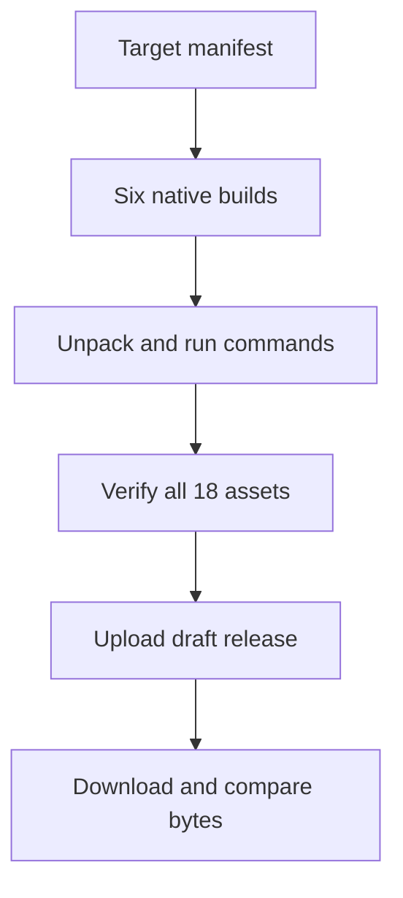

# Development release contract

ArcForge ships unsigned development archives for six primary native targets. This contract covers build inputs, delivered files, and evidence. Signed installers, notarization, installation/upgrade behavior, and native GUI interaction remain separate work in [issue #1](https://github.com/stokaro/arcforge/issues/1).

## One target manifest

[`release/targets.json`](../release/targets.json) is the source of target triples, GitHub native runner labels, archive types, and executable locations. The packager and release verifier read the same file. `cargo xtask ci-matrix` emits its validated CI matrix as a single JSON object; the CI workflow consumes that output instead of maintaining another target list.

The required platforms remain macOS, Windows, and GNU/Linux on x86-64 and ARM64. Changing target coverage requires an explicit contract change and review of the packaging layout, native prerequisites, and evidence. A missing job or artifact is a failure, not a reduced release matrix.

## Package and inspect on the native target

```sh
cargo xtask package --target x86_64-unknown-linux-gnu
cargo xtask verify-package --target x86_64-unknown-linux-gnu
```

Packaging always uses the release profile. Each archive has one root directory named `arcforge-{version}-{target}`. It contains the GUI and CLI in the manifest's locations, development documentation, licenses, dependency inventory, and `BUILD-INFO.json`. That metadata records the version, target, source commit, dirty-tree state, and target-manifest hash. The macOS application bundle retains its notices when moved away from the surrounding directory.

The packager checks executable architecture before archiving. `verify-package` reads the produced archive and its SHA-256 sidecar, extracts to a fresh isolated temporary directory, checks the exact file inventory/metadata and binary architecture again, and runs the delivered executables there. It rejects unsafe paths, duplicate entries, inconsistent ZIP headers, links/special files, and extraction beyond its configured bounds. This validator accepts ArcForge's generated development layout; it is not the application's general-purpose archive provider.

The current limits are 512 MiB for the archive or any individual file, 2 GiB for the expanded stream/content, and 10,000 entries. ZIP uses stored regular files and a classic bounded central directory; ZIP64 is outside these development-bundle limits. TAR permits regular files and bounded GNU long-name records (up to 1,200 bytes), rejecting PAX, links, and other special records before their payloads can be expanded into metadata buffers. Increasing package size or changing the writer's format requires an explicit matching verifier change.

Native verification runs these seven commands from the unpacked bundle and checks their exit/output contracts:

| Executable | Arguments | Evidence |
| --- | --- | --- |
| CLI | `--version` | Expected application/version output |
| CLI | `commands --json` | Valid command catalog with truthful availability |
| CLI | `doctor --json` | Valid capability report for ZIP browsing, preview, and extraction |
| GUI | `--version` | Expected version output without opening a window |
| CLI | `list arcforge-smoke.zip --json` | Expected entries and metadata from the independent ZIP fixture |
| CLI | `preview arcforge-smoke.zip --entry 1 --json` | Expected Deflate entry bytes and verified CRC32 |
| CLI | `extract arcforge-smoke.zip --output arcforge-smoke-output --json` | Completed report, exact contents of both files, and unchanged source fixture |

The ZIP commands use `arcforge-smoke.zip`, materialized in the isolated verification directory from the committed [Python zipfile fixture](../tests/fixtures/python-zipfile.hex). It contains independently generated Stored and Deflate entries. The optional [fixture generator](../scripts/generate_zip_fixture.py) uses Python; package verification consumes the committed bytes without requiring Python.

The verifier writes an evidence sidecar only after all checks pass, and removes previous evidence before a new attempt. The record binds the artifact name/hash, build metadata, native host target, and seven successful command records. Its evidence class is **`native-command-smoke`**. This proves those packaged commands ran on that target. It does not prove window rendering, accessibility, file associations, drag-and-drop, installer behavior, or archive-feature parity.

Local packages may record a dirty source tree for development. Such a package cannot satisfy the release gate. Run native verification only for a bundle you intentionally built from trusted source: executing its binaries is part of the command.

## Complete artifact set

For every manifest target, the expected assets are:

1. `arcforge-{version}-{target}.{zip|tar.gz}`.
2. The archive's exact filename followed by `.sha256`.
3. `arcforge-{version}-{target}.evidence.json`.

The six targets therefore require **18 files**. `verify-release` rejects missing or extra files, incorrect checksums, mismatched target/version/manifest/source metadata, dirty builds, and missing or inconsistent native command evidence. It validates packages without executing binaries for other operating systems.

```sh
cargo xtask verify-release --directory dist --commit FULL_SOURCE_COMMIT_SHA
```

The source commit is required and must identify the checkout used to produce all six bundles. PR builds may use GitHub's merge commit rather than the PR branch head; record both when reporting CI results. A version string or a passing check for an older commit is insufficient. Evidence is a consistency record from trusted native CI, not a signature or independent supply-chain attestation.

CI selects a Rust host toolchain matching each native target, runs the per-target package verification before upload, then downloads all six jobs' assets and runs the complete-set verifier. This exercises the release inventory on pull requests as well as on the main branch and tag builds.

## Draft release workflow

The tag workflow requires `v{workspace-version}`, waits for native CI and complete-set validation, downloads the artifacts, and verifies them against the checked-out tag commit again. It creates a **draft** release with the exact asset set. It then downloads every uploaded asset into a new directory, reruns `verify-release`, and compares every downloaded file byte-for-byte with its prepared counterpart. A failed comparison leaves the workflow failed and the release a draft for investigation; it does not publish a partial release or replace existing assets silently.



The GitHub release service itself is exercised when a version tag is intentionally released. A passing PR validates the packager, native command evidence, and complete asset set; it does not claim that a draft was uploaded. The workflow never creates a release merely to test a PR.

## Maintaining this contract

When changing the manifest or bundle contents, update the relevant package/verification tests and this document. Keep negative coverage for damaged or mislabeled packages, unsafe entries, stale evidence, and incomplete sets. Further implemented archive commands must update the smoke output contract to match real capabilities; do not retain obsolete capability expectations or substitute planned success.

The approach adapts the release requirements of [hiewbie](hiewbie-reuse.md). The Rust implementation belongs to ArcForge; no working hiewbie build system was copied.
