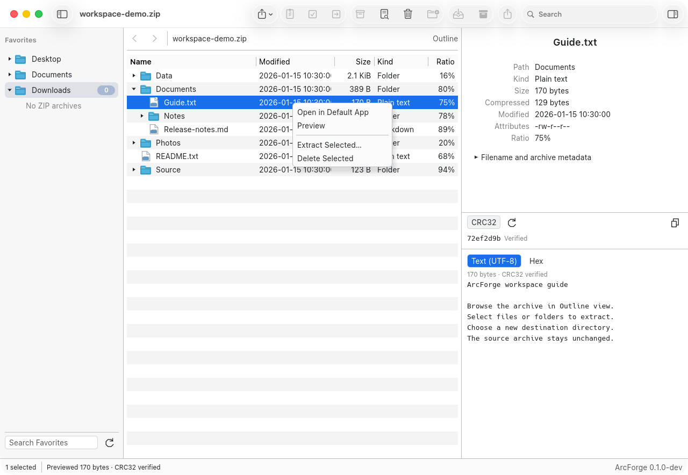

# Archive context menu

Right-click Guide.txt in the archive table. The menu appears at the clicked
row with Open in Default App, Preview, Extract Selected and Delete Selected.
Right-clicking an already selected row keeps the whole selection for
extraction and staged deletion.

| Platform | Screenshot | Area |
| --- | --- | --- |
| macOS 26 ARM64 | [PNG](macos-26-aarch64-apple-darwin/01-context-menu.png) | 1280 × 884 with AppKit titlebar and toolbar |
| Windows x64 | [PNG](x86_64-pc-windows-msvc/01-context-menu.png) | 1024 × 768 client area |
| Linux x64 | [PNG](x86_64-unknown-linux-gnu/01-context-menu.png) | 1280 × 800 X11 client area |

## Capture details

The [native CI run](https://github.com/stokaro/arcforge/actions/runs/46153692964)
used checkout `d44ba0cb1b652a0484af89b8009fa7e0cdf24eb7`, with the same
content tree as [the implementation commit](https://github.com/stokaro/arcforge/tree/9949a515a772e055dcc7eeb3cf6078125932b9d5).
All three captures use Glow at scale 1 in light mode. The per-platform
provenance records the renderer, OS build, viewport, fonts and PNG hash.

The four menu labels, selected filename and Info/Preview are readable at each
size. The macOS window uses its native AppKit chrome. Its Modified column
clips the final timestamp digit. The Windows table shows a horizontal
scrollbar at this width. Toolbar and column differences from the reference
are recorded in the [reference inventory](../../docs/reference/betterzip-6.md).

## Reproduce

Generate the fixture with
`python3 scripts/generate_ui_fixture.py workspace-demo.zip --images`, open it,
expand Documents and right-click Guide.txt. To repeat the native capture, run
`cargo xtask gui-capture --directory target/native-gui/context-menu-review`
in a [supported desktop session](../../docs/native-captures.md).

The harness sends a secondary-button press and release to the selected row
in the real window. It waits for the popup to settle and records two rendered
frames before taking the screenshot.
