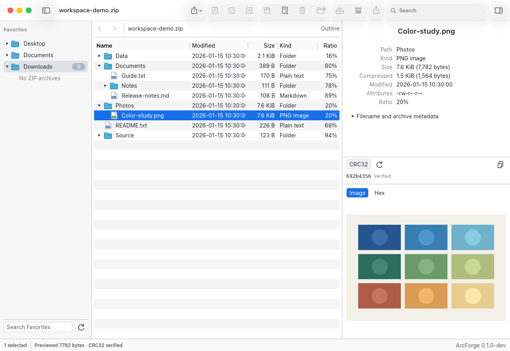
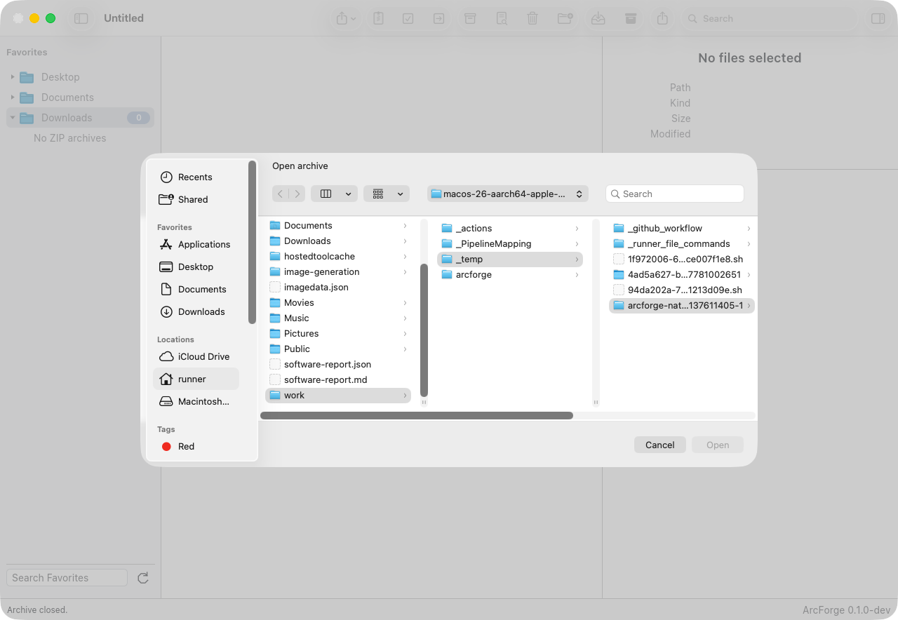

# BetterZip 6 native workspace iteration

These are **unaltered captures of the running ArcForge application** on macOS,
Windows and Linux, recorded on 2026-11-28. macOS is the primary comparison target.
The source is PR head `2a231383216c71624d8706ff7247901fa9800730`, checked out by CI
as merge commit `ecdc089feeb7d106cb802e3945fc8be04f4c2745`. Both have source tree
`9eb4afa9ece1bd36b8eca82f097a2550d00601df`; the checkout was clean. Later commits
that add this evidence do not change the captured application.

[CI run](https://github.com/stokaro/arcforge/actions/runs/46137611405) and
[evidence.json](evidence.json) identify the source parents, original artifact
digests and every retained scene hash. Each platform directory contains its
original `capture-run.json` and scene metadata. The PNG bytes have not been
cropped, composited, rescaled or retouched.

## macOS 26: actual native window and Open panel

The toolbar, window controls, search field and Open panel in these images are
AppKit UI. The archive table and inspector are the shared egui content.





| Scene | Native window | Client framebuffer and metadata |
| --- | --- | --- |
| Text preview | [01-text-preview](macos-26-aarch64-apple-darwin/01-text-preview-native-window.png) | [PNG](macos-26-aarch64-apple-darwin/client/01-text-preview.png), [JSON](macos-26-aarch64-apple-darwin/client/01-text-preview.json) |
| Image preview | [02-image-preview](macos-26-aarch64-apple-darwin/02-image-preview-native-window.png) | [PNG](macos-26-aarch64-apple-darwin/client/02-image-preview.png), [JSON](macos-26-aarch64-apple-darwin/client/02-image-preview.json) |
| Empty document after Close | [03-empty-window](macos-26-aarch64-apple-darwin/03-empty-window-native-window.png) | [PNG](macos-26-aarch64-apple-darwin/client/03-empty-window.png), [JSON](macos-26-aarch64-apple-darwin/client/03-empty-window.json) |
| Native Open panel from the empty document | [04-open-panel](macos-26-aarch64-apple-darwin/04-open-panel-native-window.png) | [Panel identity/readiness JSON](macos-26-aarch64-apple-darwin/client/04-open-panel.json); no fabricated client PNG |

The window captures are **1280 × 884**; the real client framebuffer is
**1280 × 832**, at **1×**, in light appearance. The runtime is macOS **26.7.2**,
build **25G332**, ARM64, runner image **20261123.0526.1**. Typography uses the
installed SFNS system font at actual regular 400 and semibold 600 weights.

The application window is ID 30, PID 2000. The actual Open panel is ID 43,
parented to window 30. Its observed bounds are 880 × 448, while the system's
window capture includes the parent-and-sheet composition at 1280 × 884. This is
the original `screencapture` output, not an assembled image. The helper captured
the exact owned window after observing stable visible bounds. Existing capture
permission was unchanged.

The CI display changed from 1024 × 768 to an advertised 1600 × 1200 mode for that
temporary login session. A separate observer process confirmed that the mode
survived the setter process before ArcForge launched. Actual image dimensions,
not the requested mode, establish the resulting window size. See
[capture provenance](macos-26-aarch64-apple-darwin/capture-run.json).

## Windows and Linux

These are real native client-area frames. They exclude OS titlebars, borders and
shadows. No macOS frame has been applied to either platform.

| Platform | Text preview | Image preview | Empty document | Actual runtime |
| --- | --- | --- | --- | --- |
| Windows ARM64 | [01](aarch64-pc-windows-msvc/client/01-text-preview.png) | [02](aarch64-pc-windows-msvc/client/02-image-preview.png) | [03](aarch64-pc-windows-msvc/client/03-empty-window.png) | Windows 11 build 26200.9974; 1024 × 768, 1×; Segoe UI regular/semibold; native WGL with CI-only Mesa llvmpipe |
| Linux x86-64 | [01](x86_64-unknown-linux-gnu/client/01-text-preview.png) | [02](x86_64-unknown-linux-gnu/client/02-image-preview.png) | [03](x86_64-unknown-linux-gnu/client/03-empty-window.png) | Ubuntu 24.04 runner; X11/Xvfb and Mesa; 1280 × 800, 1× |

The Windows set retains the ARM64 images because they contain no incidental
hover tooltip. The same run also captured x64 successfully; its image-preview
frame contains a real hover tooltip and remains in the CI artifact. The
retained ARM64 viewport reports `focused=false`, so it does not verify keyboard
focus behavior. Windows Open-panel appearance is not covered by these scenes.

Linux evidence establishes native X11 client rendering in a virtual display,
not physical-GPU or Wayland behavior. A separate local graphical session lacked
both a FileChooser portal and Zenity, so its native Open-panel check was blocked.
The dependency and current diagnostic limitation are documented in
[Linux runtime prerequisites](../../docs/development.md#linux-native-file-panels-at-runtime).
No successful Linux picker/cancellation test is claimed here.

The CI matrix also captures Linux ARM64 and macOS Intel/Apple Silicon on its
regular release runners. Their artifacts are linked from the run; the retained
gallery focuses on one inspected set per OS and the primary macOS 26 appearance.
No Mesa DLL or helper executable is included in this screenshot directory.

## Reproduce the scenes

Use the pinned toolchain, a native desktop session, a clean checkout of the
captured source, and a new output directory:

```sh
cargo xtask gui-capture --directory target/native-gui/visual-review
```

The command builds the actual desktop with the development-only `native-capture`
feature and the production Glow renderer. It generates the original fixture,
opens it through the ordinary archive worker, and waits for completed results.
It saves the second actual renderer callback after each client state is ready;
macOS additionally records real OS windows. It neither substitutes a mock
snapshot nor uses an offscreen recreation. Detailed steps and runtime limits
are in [native capture documentation](../../docs/native-captures.md).

The retained [workspace-demo.zip](workspace-demo.zip) is reproducible using
`scripts/generate_ui_fixture.py --images`. Its SHA-256 is
`eef9fd6de48a3e465ab99dae9cdb5df13353e25056fe9365584d9e722d0da70e`.
The generator SHA-256 is
`f08427b3389702f953b7bbf84c14dc37dfe1a82b982864f3897ac7290a157aec`.
All file contents and the color-study image are original repository fixtures;
no BetterZip images or private documents are included.

1. Open the fixture in Outline view; expand Documents and select
   `Documents/Guide.txt`. Wait for the complete 170-byte, CRC-verified text preview.
2. Expand Photos and select `Photos/Color-study.png`. Wait for the complete
   7782-byte, CRC-verified entry and decoded 960 × 640 image texture.
3. Close the archive. Verify cleared selection/preview and the empty three-pane
   document. This is the empty state after Close, not a claimed fresh-process
   startup capture.
4. On macOS, request normal Open from that empty document. Verify the real owned
   native panel and its parent, capture it, then cancel that panel and exit.

Favorites are actual host directories and complete-scan ZIP candidate counts.
Their contents are deliberately not fabricated to match the reference image.
Each manifest verifies that both the fixture and executable remained unchanged.

## Visual review against the supplied BetterZip 6 references

| Area | Observed improvement | Remaining difference or unverified behavior |
| --- | --- | --- |
| Window and toolbar | Real unified AppKit chrome, real window controls, system symbols, native menus/search; Extract and Move no longer fall back to text | Exact group boundaries, filename/proxy-icon placement, selected-toggle appearance and toolbar customization still need closer reference matching |
| Normal Open | Real macOS file panel replaces the handmade path-entry form | Destination/options accessories and Windows/Linux panel interactions need native verification |
| Typography | Genuine system regular/semibold faces; readable heading and metadata hierarchy | Sizes/density need comparison at matched reference scale; screenshots do not establish accessibility or IME behavior |
| Pane geometry | Approximately 18/49/33 at the wide viewport; useful inspector/preview width | No claim of exact geometry from reference images whose logical scale is unknown |
| Favorites | Real filesystem places and counts; count badge stays within narrow pane | Persistent/custom places, watching, and full Finder-style icon treatment remain planned |
| Outline | Hierarchy, full-row selection, continuing alternating rows and main columns | Fixed column widths can clip long dates/type text; ellipsis/date formatting and column resizing/reordering remain open |
| Inspector and preview | Ordinary properties/disclosure fit; overflow is scrollable; real text and image content | Checksum selection remains CRC32; formatting, preview controls and large-image behavior differ from BetterZip |
| Empty document | Places, central drop target and quiet No files selected inspector | Compression/creation is not implemented, so the hint only offers opening archives |

All 13 retained PNGs were visually inspected. The earlier rejected handmade
Open form and misaligned painted macOS toolbar are replaced in this revision.
These screenshots demonstrate that change; **they do not close the overall
BetterZip 6 fidelity gate**. Presets, password sheets, settings layout,
editing/saving and other incomplete operations remain separate work.

Related tasks: [native macOS/Windows previews #13](https://github.com/stokaro/arcforge/issues/13),
[Linux integration research #14](https://github.com/stokaro/arcforge/issues/14),
and [portable scripting research #15](https://github.com/stokaro/arcforge/issues/15).
