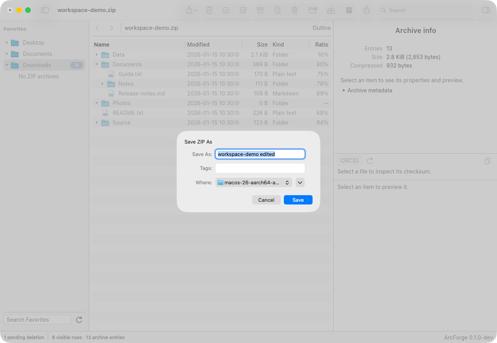

# Staged ZIP deletion and Save As

The test fixture opens with 14 archive entries. Delete stages the removal of
`Photos/Color-study.png`. The file disappears from Outline, the status bar
shows one pending deletion, and the archive inspector reports 13 entries. The
close prompt asks whether to discard the staged change. Save As opens the
system picker. A rejected destination leaves the edit staged. A successful
save opens the new ZIP with a clean document and 13 verified entries.

| Scene | macOS 26 ARM64 | Windows x64 | Linux x64 |
| --- | --- | --- | --- |
| Staged deletion | [PNG](macos-26-aarch64-apple-darwin/05-staged-delete-native-window.png) | [PNG](x86_64-pc-windows-msvc/05-staged-delete.png) | [PNG](x86_64-unknown-linux-gnu/05-staged-delete.png) |
| Close with unsaved changes | [PNG](macos-26-aarch64-apple-darwin/06-discard-prompt-native-window.png) | [PNG](x86_64-pc-windows-msvc/06-discard-prompt.png) | [PNG](x86_64-unknown-linux-gnu/06-discard-prompt.png) |
| System Save As panel | [PNG](macos-26-aarch64-apple-darwin/07-save-panel-native-window.png) | — | — |
| Existing destination rejected | [PNG](macos-26-aarch64-apple-darwin/08-save-collision-native-window.png) | [PNG](x86_64-pc-windows-msvc/08-save-collision.png) | [PNG](x86_64-unknown-linux-gnu/08-save-collision.png) |
| Saved copy open | [PNG](macos-26-aarch64-apple-darwin/09-saved-copy-native-window.png) | [PNG](x86_64-pc-windows-msvc/09-saved-copy.png) | [PNG](x86_64-unknown-linux-gnu/09-saved-copy.png) |

## Capture details

All PNGs came from the [same native CI run](https://github.com/stokaro/arcforge/actions/runs/46142627237) at
[checkout `06c11d1d3990`](https://github.com/stokaro/arcforge/tree/06c11d1d3990ac64d86ba4e85919ee2aa83db90b), tree `5e6a809f870b908ffbbd1bba7e8241981374c609`. The three
folders include the native process, OS build, capture kind, scale and hashes.

| Platform | Captured area | Renderer |
| --- | --- | --- |
| macOS 26, ARM64 | 1280 × 884, 1×, light. AppKit window with its actual toolbar, traffic lights and Save As sheet | Glow with the native AppKit shell |
| Windows x64 | Actual 1024 × 768 client area, 1×, light | Glow/WGL with the CI Mesa driver |
| Linux x64 | Actual 1280 × 800 X11 client area, 1×, light | Glow with Mesa in Xvfb |

The macOS close button carries the native dirty indicator until the copy opens.
The discard confirmation comes from the shared workspace. At these widths,
the macOS Modified column clips the final timestamp digit and the Windows
contents table uses its horizontal scrollbar. Existing differences in column
layout and toolbar grouping remain listed in the
[reference inventory](../../docs/reference/betterzip-6.md).

## Reproduce

Run `cargo xtask gui-capture --directory target/native-gui/zip-edit-review`
in a native desktop session at the checked application revision. See the
[capture prerequisites](../../docs/native-captures.md). For an interactive run,
generate the fixture with `python3 scripts/generate_ui_fixture.py workspace-demo.zip --images`
and open it. Expand Photos, select Color-study.png and choose Delete. Try Undo
and Redo, then Close and Cancel. Save As to an unused filename on a filesystem
that supports hard links.

The macOS harness captures and cancels its owned native Save As sheet. The
existing-filename rejection and the successful save use the same
workspace save controller on all three systems. The Windows and Linux images
show client UI and save outcomes. Native picker images cover macOS.

The per-platform capture records include SHA-256 for the generated source and
saved copy. Independent Python `zipfile` verification compared names, CRC
results, archive comment and every retained payload. The source file's SHA-256
remained unchanged across each capture.
