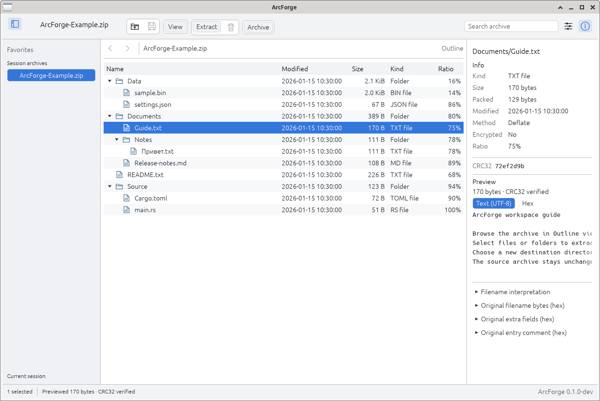
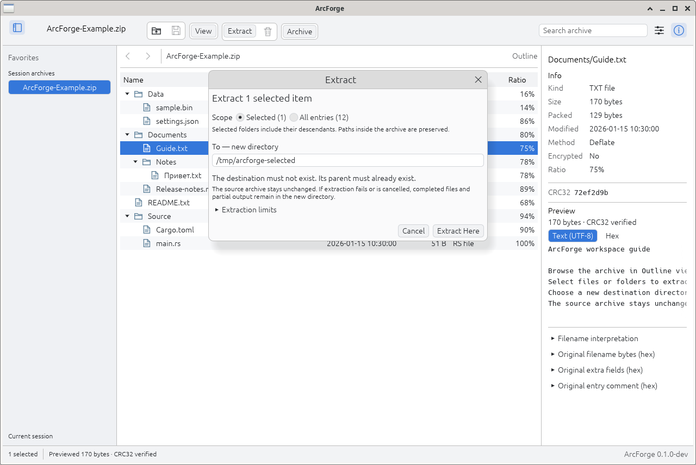
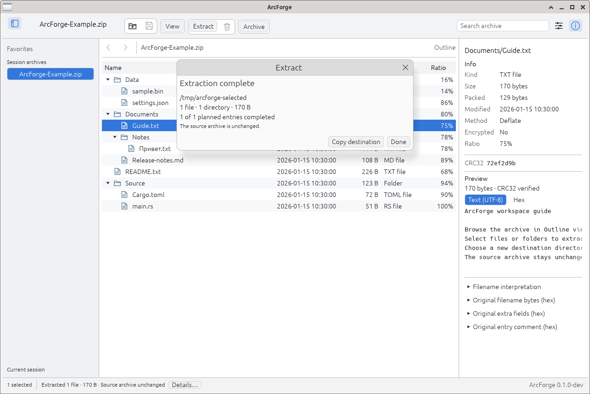
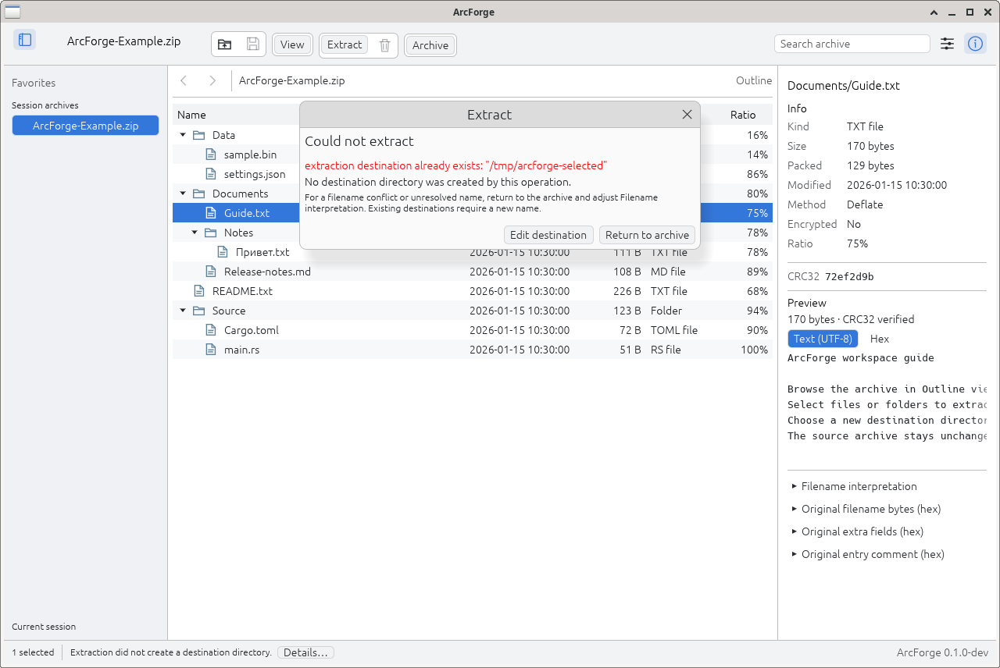
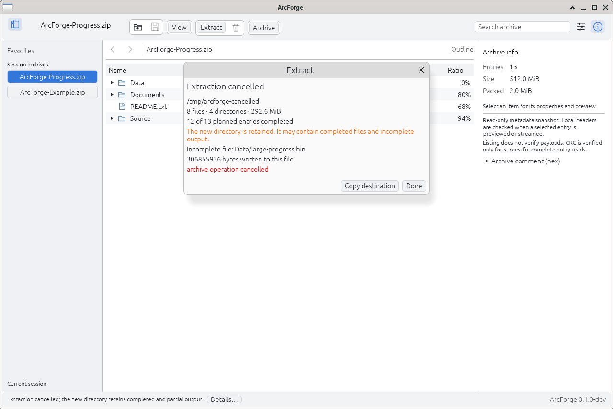

# ZIP extraction scenes

Actual native ArcForge captures, recorded on **2026-11-28**. The reference priority is [BetterZip 6, with OpenZip for unresolved details](../../docs/reference/betterzip-6.md). These scenes demonstrate the implemented workspace and new-directory extraction slice; they do not establish complete BetterZip parity.

## Captured environment and source

| Item | Recorded value |
| --- | --- |
| Native platform | Debian GNU/Linux 13.7, x86_64, X11 with Xfwm4 |
| Toolkit | Rust desktop using eframe/egui 0.37.0 |
| Theme and scale | Light, 1 physical pixel per logical pixel |
| Application content | 1270 × 822 pixels; Favorites resized to about 210 pixels and Info to about 280 pixels |
| Image dimensions | 1280 × 856 pixels including native Linux window decoration |
| Capture method | GIMP's single-window screenshot command, exported directly as PNG; no drawn replacements, compositing, image resizing, or post-capture pixel edits |
| Workspace scene 01 | Commit [`8f928f6`](https://github.com/stokaro/arcforge/commit/8f928f6d6ebd38d6c74a3294cf32de86a4808393), no local code changes |
| Extraction scenes 02–05 | Commit [`232f145`](https://github.com/stokaro/arcforge/commit/232f145df7aca73ad6497d221f6fed9e9e1ff617), no local code changes |
| Build and checks | Pinned Rust 1.100.1; `cargo xtask check` passed with 147 tests for the final code state, including `cargo build --locked --workspace --all-features` |

The later commit fixes extraction-dialog footer allocation and adds a regression that checks the actual window's measured height across viewport sizes. It does not change the closed-dialog workspace shown in scene 01. Screenshot/docs additions after these commits do not change executable code.

## Reproducible fixtures

The optional [fixture generator](../../scripts/generate_ui_fixture.py) uses Python's ZIP writer and original MIT-licensed text/binary content. Normal Rust builds and tests do not require Python. Run from the repository root, choosing output paths that do not already exist:

```sh
python3 scripts/generate_ui_fixture.py /path/to/ArcForge-Example.zip
python3 scripts/generate_ui_fixture.py /path/to/ArcForge-Progress.zip --large-mib 512
cargo build --locked --workspace --all-features
target/debug/arcforge /path/to/ArcForge-Example.zip
```

Use the equivalent executable path on Windows. The screenshots use absolute native paths; they are not application defaults or portability requirements.

| Fixture | Contents | Captured ZIP SHA-256 |
| --- | --- | --- |
| `ArcForge-Example.zip` | 12 records: four directories and eight files, including nested UTF-8 text, Rust/TOML/JSON, and binary data; 2,299 ZIP bytes | `b84d5772719bbbd344671c87f786536b8ed6843aac1813baecb43e5f175adb57` |
| `ArcForge-Progress.zip` | The same records plus `Data/large-progress.bin`, 512 MiB before compression; 2,085,356 ZIP bytes | `de914e635e653f29b14ae596c7944e5323716f137b554ad3060d5ccc1684794b` |

Entry timestamps are fixed at 2026-01-15 10:30:00. ZIP byte hashes identify the captured inputs; another Python/zlib implementation can produce different compressed bytes without changing fixture contents. The large payload is generated in bounded chunks and is not committed to the repository.

## Scenes and readiness conditions

| Scene | Actions and visible readiness |
| --- | --- |
| [01 — Workspace](01-workspace.png) | Open the small fixture, resize the window/panes, expand Data, Documents, Notes, and Source, then select `Documents/Guide.txt`. Wait for its text preview and “CRC32 verified” status. |
| [02 — Extract selected](02-extract-selected.png) | Choose **Extract → Extract Selected…** with Guide selected. Enter a fresh destination, `/tmp/arcforge-selected` in this run. Wait for the compact form to settle; scope, destination and output-retention policy are visible. No extraction has started in this image. |
| [03 — Completed](03-completed.png) | Click **Extract Here**. Capture the terminal “Extraction complete” result: one completed file, one directory, 170 bytes, and one of one planned entries completed. |
| [04 — Existing destination](04-existing-destination.png) | Dismiss the result, repeat selected extraction into the same destination, and capture “Could not extract”. This is a rejection before creating output for the second attempt. The previously extracted file remains. |
| [05 — Cancelled](05-cancelled.png) | Open the large fixture, choose **Extract → Extract All…**, and use a fresh `/tmp/arcforge-cancelled` destination. After actual writing/progress appears, click **Cancel extraction**. Wait for the worker's final “Extraction cancelled” report before capturing. |

The cancellation run first visibly reported 12 of 13 entries and 5.8 MiB written. The final report retained eight completed files and four directories plus an incomplete `Data/large-progress.bin` containing **306,855,936 bytes**. Total output was **306,858,789 bytes**. Timing and byte counts will vary on another machine; they are observed values, not screenshot fixtures injected into the UI. Use another fresh destination for a rerun.

## Behavioral verification alongside the images

An independent Python `zipfile` check ran in the native application's filesystem environment after scenes 03–05. The [recorded result](native-verification.json) confirms:

- Selected extraction produced exactly `Documents/Guide.txt`, with the expected 170 bytes. Its inventory and content still matched after the existing-destination refusal.
- Each of the eight completed files from the cancelled operation exactly matched its archive payload. The incomplete file matched the corresponding archive prefix byte for byte, and its length matched the UI report. The nine physical files include that incomplete file; the UI's eight-file count is the completed-file count.
- Both original ZIP SHA-256 values were unchanged.

Additional native interaction checks covered pane resizing, outline disclosures, text-preview horizontal scrolling, Ctrl+A, Ctrl+F, matching/empty search states, the Flat menu, and Ctrl+2 returning to Outline. The screenshot's clipped long preview lines are accessible by horizontal scrolling. Automated controller tests cover modifier/range selection; this capture session does not claim native modifier-click, accessibility, drag-and-drop, or macOS/Windows GUI coverage.

All five PNGs were inspected individually and received a focused independent visual review. The review distinguishes successful completion, preflight rejection and cancellation with retained output. A static image does not establish archive correctness by itself.

## Reference differences still open

The visible structure follows the official BetterZip 6 image: integrated filename/actions/search, Favorites on the left, central Outline, navigation above the table, Name/Modified/Size/Kind/Ratio, and Info/Preview on the right. Folder totals in Outline are descendant totals; Ratio is compressed/original size.

Native Linux window chrome, some text toolbar menus, the extra status footer, session-only Favorites, and the portable destination form are current adaptations. Filesystem Favorites browsing, native destination pickers, Columns/Icons, broader previews, persistent preferences, archive editing and Save remain planned. The official reference image is beta-labelled; final BetterZip runtime geometry, fonts and all secondary interactions have not been established. See the [parity inventory](../../docs/reference/betterzip-6.md#state-and-parity-inventory).

## Images

### 01 — Workspace and selected preview



### 02 — Selected extraction into a new directory



### 03 — Completed extraction



### 04 — Existing-destination refusal



### 05 — Cancelled extraction with retained partial output


