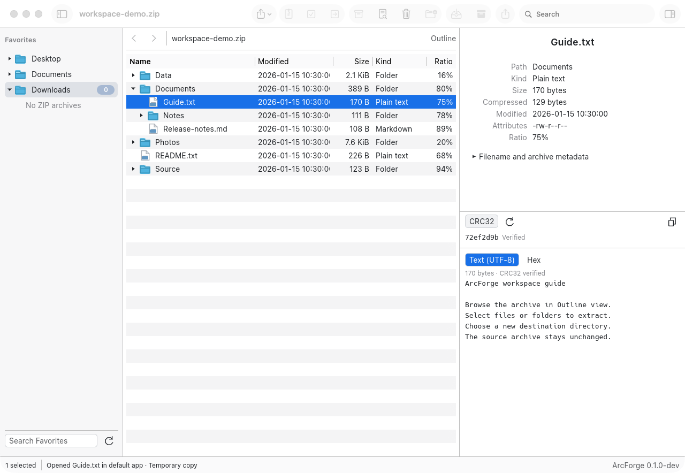

# Open an archive file

Double-click `Documents/Guide.txt` in the archive table. The status bar shows
**Opened Guide.txt in default app · Temporary copy** after the system accepts
the file. These are captures of the ArcForge window after that handoff.

| Platform | Screenshot | Area |
| --- | --- | --- |
| macOS 26 ARM64 | [PNG](macos-26-aarch64-apple-darwin/01-opened-file.png) | 1280 × 884 with AppKit titlebar and toolbar |
| Windows x64 | [PNG](x86_64-pc-windows-msvc/01-opened-file.png) | 1024 × 768 client area |
| Linux x64 | [PNG](x86_64-unknown-linux-gnu/01-opened-file.png) | 1280 × 800 X11 client area |

## Capture details

The [native CI run](https://github.com/stokaro/arcforge/actions/runs/46151146819)
used checkout `a6253af3ea72b3aefd10a0e32cce539028ab00c7`, with the same tree
as [the implementation commit](https://github.com/stokaro/arcforge/tree/918295f26c5c10a887196f7db09a42d7069313f7).
All three captures use Glow at scale 1 in light mode. The per-platform records
include OS build, viewport, font faces, application binary and image hashes.

The macOS capture shows the inactive AppKit window after the handoff. The
selected filename, Info/Preview and the bottom status are readable at each
size. The macOS Modified column clips the final timestamp digit. The narrower
Windows table clips Kind and needs horizontal scrolling for the Ratio column.
Toolbar and column differences from the reference are recorded in the
[reference inventory](../../docs/reference/betterzip-6.md).

## Reproduce

Generate the fixture with
`python3 scripts/generate_ui_fixture.py workspace-demo.zip --images`, open it,
expand Documents, and double-click Guide.txt. To repeat the capture, run
`cargo xtask gui-capture --directory target/native-gui/file-open-review`
in a [supported desktop session](../../docs/native-captures.md).

The capture harness invokes the same controller action as the double-click.
It records a successful native handoff and compares the 170-byte copy with
the CRC-verified preview. On Linux a process-local text-file handler also
records the bytes it received, which are compared independently with the source
entry using Python's `zipfile`. Each run compares the source ZIP's SHA-256
before and after the application opens the file.
